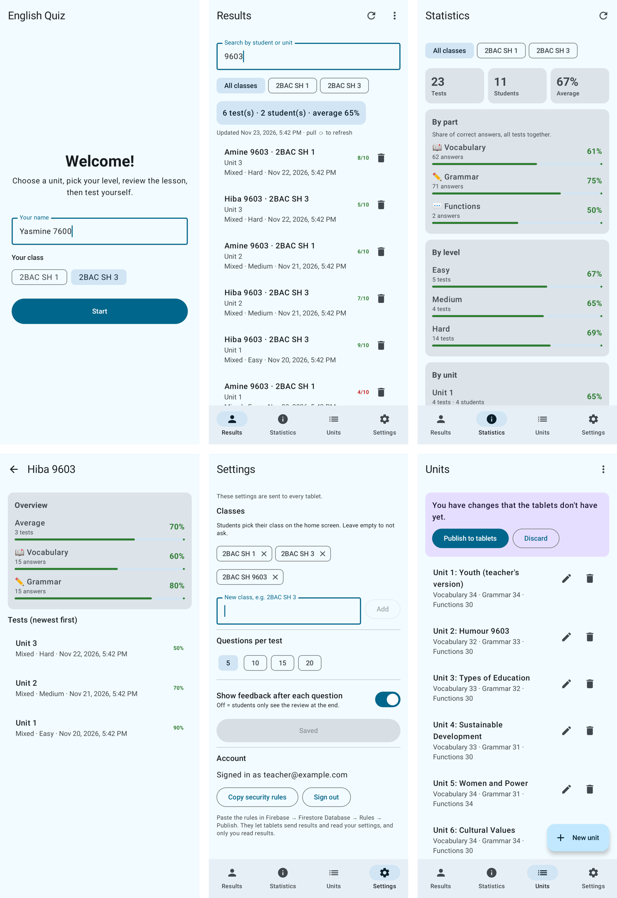

# English Quiz (Android): student app + teacher app

Two Android apps for testing 2nd-year Baccalaureate (2BAC) students on the ten units of the
*Stairway to English* booklet (based on *Ticket 2 English*). They cover **vocabulary, grammar and functions**.

- **English Quiz** (student app, on the class tablets): name, class, unit, level, focus, lesson, then the test. Results are sent to the teacher automatically.
- **English Quiz Teacher** (teacher's phone): results from every tablet, statistics, editing and publishing units, settings for all tablets.



Firebase setup (one time, about 15 minutes): **[docs/ONLINE_RESULTS_SETUP.md](docs/ONLINE_RESULTS_SETUP.md)**.

## How students use it

1. Type their name and pick a **unit** (1–10).
2. Choose **how hard** the questions should be:
   - 🟢 **Easy**: recognise the right word or form (many vocabulary questions have pictures)
   - 🟠 **Medium**: use it in a sentence
   - 🔴 **Hard**: exam-style: transform, correct, produce
3. Choose **what to practise**: Vocabulary, Grammar, Functions, or **Everything (mixed)**.
4. **Read the lesson** for that part, then start the test.
5. The test draws a **limited number of random questions** (10 by default) from the question bank, so every attempt is different.
6. At the end, they see a score and a review of every answer, with the correct answer and an explanation.

## Content

| Unit | Vocabulary | Grammar | Functions |
|---|---|---|---|
| 1 The Gifts of Youth | Qualities of youth & generation gap | Gerund & infinitive | Making and responding to requests |
| 2 Humour | Sources of humour | Present & past modals | Asking for clarification |
| 3 Types of Education | Education & literacy | Past perfect simple | Expressing purpose |
| 4 Sustainable Development | Problems & solutions | Future perfect | Cause & effect |
| 5 Women and Power | Situation of women, obstacles & factors | Passive voice | Linking words of addition & concession |
| 6 Cultural Values | Values of our culture | Phrasal verbs | Complaining & apologizing |
| 7 Citizenship | Rights & duties | Reported speech | Asking for & giving advice |
| 8 International Organizations | International organizations | Linking words (review)* | Responding to news |
| 9 Science & Technology | Science & technology | Wishes & conditional type 3 | Certainty & uncertainty |
| 10 Brain Drain | Loss of human capital | Relative pronouns | Expressing regret |

\* Unit 8 has no grammar lesson in the booklet, so its grammar part reviews linking words (the booklet's "Linking Words: Review & Practice").

There are about 960 questions, with at least 10 for every unit, part and level.

## Teacher app

- **Results**: every test finished on any tablet: student, class, unit, part, level, score and date. Search, filter by class, view every answer, delete results, export to CSV.
- **Statistics**: tests, students and average score; percentage correct by part (vocabulary / grammar / functions), by level and by unit; the 10 most-missed questions; every student's average with a progress trend (▲▼), and their full history.
- **Units**: edit lessons and questions. Each question has a level, a type, an optional picture (emoji or photo) and an explanation. **Publish to tablets** sends your version to every tablet. You can also import and export units as JSON, or restore the built-in units.
- **Settings** (sent to every tablet): class list (students pick their class on the home screen), questions per test (5 / 10 / 15 / 20), feedback after each question.

## Install on a phone or tablet

On GitHub, open **Actions**, then the latest **Build APKs** run. Download **english-quiz-student-apk** for the tablets and **english-quiz-teacher-apk** for your phone. Unzip each and open the `.apk` on the device (Android 8 or newer).

## Editing the built-in content

The built-in units are generated from the Python files in `content/` (one file per unit):

```
python3 content/build_units.py   # writes app/src/main/assets/units.json
./gradlew testStudentDebugUnitTest testTeacherDebugUnitTest   # checks every unit, part and level has at least 10 valid questions
                                 # (the online-results tests also run if the Firebase emulators are running:
                                 #  firebase emulators:start --only auth,firestore --project demo-quiz)
./gradlew assembleStudentDebug assembleTeacherDebug   # APKs in app/build/outputs/apk/{student,teacher}/debug/
```

In those files, `mc(level, prompt, [correct, wrong, …])` is a multiple-choice question; put the correct answer first, and the app shuffles the options.
`tf(level, prompt, True/False)` is true/false. `wr(level, prompt, ["answer", "alternative"])` is a question the student types; capitals, extra spaces and final punctuation are ignored.
In lesson text, `# ` starts a heading, `• ` starts a bullet, and `**word**` is bold.

Built-in units are used until the teacher publishes units from the teacher app. After that, the tablets use the published version.
